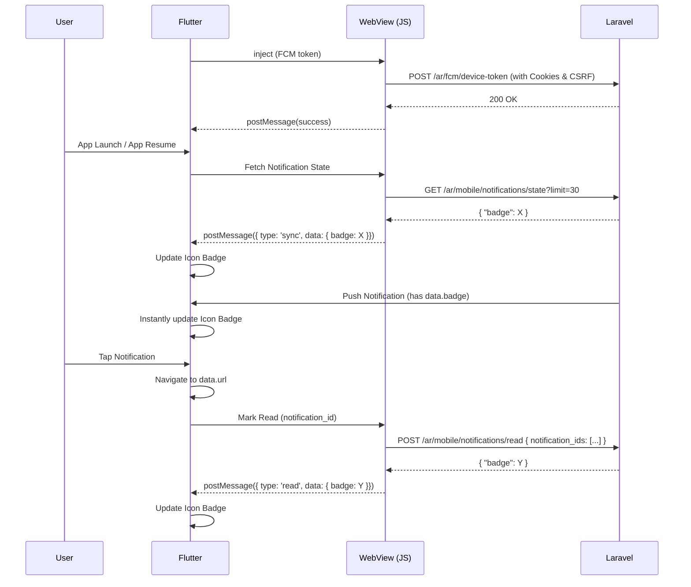

# Laravel WebView App (Flutter + Firebase Cloud Messaging)

A production-ready Flutter application that wraps an existing Laravel website
in a WebView and integrates Firebase Cloud Messaging (FCM) for push
notifications on Android and iOS, including dynamic, URL-driven deep linking
into the WebView.

This README assumes **zero prior context** — follow it top to bottom.

---

## 1. Overview

- The app shows your Laravel website full-screen inside a `WebView`.
- Firebase Cloud Messaging delivers push notifications in all app states:
  **foreground**, **background**, and **terminated**.
- Tapping a notification (or receiving one in the foreground) can navigate
  the WebView to any URL your Laravel backend specifies — **no Flutter code
  changes are needed to support new notification types**, as long as they
  just need to open a URL. See section 8, "Laravel → Flutter Payload
  Contract".

---

## 2. Folder Structure

```
lib/
  main.dart                          # Entry point: Firebase init + runApp
  app.dart                           # Root MaterialApp, navigator key, routes

  firebase/
    firebase_service.dart            # Firebase.initializeApp() wrapper
    notification_service.dart        # FCM lifecycle, local notifications,
                                      # foreground/background/terminated
                                      # handling, dynamic payload dispatch
    firebase_options_placeholder.dart# Placeholder until `flutterfire configure`
                                      # generates the real firebase_options.dart

  webview/
    webview_screen.dart              # WebView UI: progress bar, pull-to-
                                      # refresh, error screen, back nav
    webview_controller.dart          # WebViewController setup: JS, cookies,
                                      # external link handling, FCM + badge sync

  services/
    navigation_service.dart          # Global navigator key + URL notifier so
                                      # notification taps can navigate the
                                      # WebView from anywhere (no BuildContext
                                      # needed)
    permission_service.dart          # Android 13 POST_NOTIFICATIONS + iOS
                                      # notification permission requests
    notification_state_service.dart  # Automatic badge sync with the backend
                                      # upon launch, resume, and notification tap.

  models/
    notification_payload.dart        # Typed, extensible parser for the FCM
                                      # `data` payload + type→action switch

  routes/
    app_routes.dart                  # Named route table

  utils/
    constants.dart                   # URLs, channel ids, payload key names

README.md
```

## 2.1 Badge Synchronization & Notification State Flow

This application is strictly configured to **never calculate application icon badges locally**. Laravel is the only source of truth.

### Endpoints integration:
- `POST /ar/fcm/device-token`: Automatically executed inside the authenticated WebView context to bind the device's FCM token to the active `/ar` Laravel session.
- `GET /ar/mobile/notifications/state?limit=30`: Called on app launch, app resume, and page navigation (like opening the notifications screen / logging in). It returns `{ "badge": X, ... }`, and the generic application icon badge immediately synchronizes with this value.
- `POST /ar/mobile/notifications/read`: Invoked automatically when a push notification is tapped in any state (foreground, background, terminated). Body `{ "notification_ids": ["..."] }` or `{ "mark_all": true }`. The response `{ "badge": X }` updates the app badge instantaneously.

### Complete Sequence Diagram


---

## 3. Packages Used

| Package                        | Purpose                                          |
|---------------------------------|---------------------------------------------------|
| `firebase_core`                 | Firebase SDK bootstrap                             |
| `firebase_messaging`            | Push notifications (FCM)                           |
| `flutter_local_notifications`   | Displaying notifications while app is foregrounded |
| `webview_flutter`                | Rendering the Laravel website                      |
| `url_launcher`                  | Opening external links outside the WebView         |
| `permission_handler`            | Android 13+ runtime notification permission        |

All versions are pinned in `pubspec.yaml`. Run `flutter pub outdated`
periodically and bump them — this project intentionally avoids deprecated
APIs as of early-to-mid 2026, but Firebase/Flutter plugins update often.

---

## 4. Installation

```bash
# 1. Create a new Flutter project (or drop these files into an existing one)
flutter create laravel_webview_app
cd laravel_webview_app

# 2. Replace the generated lib/ folder with the one provided here, and
#    replace pubspec.yaml's dependencies section with the one provided here.

# 3. Install dependencies
flutter pub get

# 4. Install the FlutterFire CLI (one-time, global)
dart pub global activate flutterfire_cli

# 5. Log into Firebase CLI (one-time)
firebase login

# 6. Run the configure wizard (see Section 5 first)
flutterfire configure
```

---

## 5. Firebase Console Setup (step-by-step)

### 5.1 Create the Firebase Project

1. Go to <https://console.firebase.google.com>.
2. Click **Add project** → name it (e.g. `my-laravel-app`) → follow the
   wizard (Google Analytics is optional) → **Create project**.

### 5.2 Add the Android App

1. In the Firebase console, click the **Android icon** to add an app.
2. **Android package name**: must exactly match your app's
   `applicationId` in `android/app/build.gradle` (e.g.
   `com.example.laravel_webview_app`).
3. **Debug signing certificate SHA-1** (required for some Firebase features,
   and required later if you add Google Sign-In / Dynamic Links):
   ```bash
   cd android
   ./gradlew signingReport
   ```
   Copy the `SHA1` value under the `debug` variant and paste it into the
   Firebase console field.
4. Click **Register app**.
5. **Download `google-services.json`**.
6. Place it at:
   ```
   android/app/google-services.json
   ```

### 5.3 Add the iOS App

1. In the Firebase console, click **Add app → iOS**.
2. **iOS bundle ID**: must exactly match the Bundle Identifier in Xcode
   (Runner target → General → Identity). Open `ios/Runner.xcworkspace` in
   Xcode to check/set it.
3. Click **Register app**.
4. **Download `GoogleService-Info.plist`**.
5. Open `ios/Runner.xcworkspace` in Xcode, right-click the `Runner` folder
   in the project navigator → **Add Files to "Runner"** → select
   `GoogleService-Info.plist` → make sure **"Copy items if needed"** and
   the **Runner target** checkbox are both checked.

### 5.4 Run FlutterFire Configure

Instead of manually wiring platform config, let the CLI generate
`lib/firebase_options.dart` and confirm the native files are placed
correctly:

```bash
flutterfire configure
```

- Select your Firebase project.
- Select **android** and **ios** platforms.
- This generates `lib/firebase_options.dart` with a `DefaultFirebaseOptions`
  class.

**Then update the code:**

In `lib/firebase/firebase_service.dart` and
`lib/firebase/notification_service.dart`, replace:

```dart
import 'firebase_options_placeholder.dart';
...
options: FirebaseOptionsPlaceholder.currentPlatform,
```

with:

```dart
import '../firebase_options.dart'; // adjust relative path as needed
...
options: DefaultFirebaseOptions.currentPlatform,
```

You can then delete `firebase_options_placeholder.dart`.

### 5.5 Generate the Firebase Admin SDK Private Key (for Laravel)

Your Laravel backend needs this to send notifications via the Firebase
Admin SDK (or the legacy/HTTP v1 API):

1. Firebase console → **Project settings (gear icon) → Service accounts**.
2. Click **Generate new private key** → confirm.
3. A `.json` file downloads (e.g. `my-laravel-app-firebase-adminsdk-xxxxx.json`).
4. **Store this file securely on your Laravel server** (never commit it to
   git). A common location:
   ```
   storage/app/firebase/firebase-adminsdk.json
   ```
5. Add it to `.gitignore`.
6. Reference its path in Laravel's `.env`, e.g.:
   ```
   FIREBASE_CREDENTIALS=storage/app/firebase/firebase-adminsdk.json
   ```

---

## 6. Android Native Modifications Required

> These are native project files (`android/`) NOT included in this
> deliverable — you must make these edits yourself in your generated
> Android project.

### 6.1 `android/build.gradle` (project-level)

Add the Google Services classpath:

```gradle
buildscript {
    dependencies {
        classpath 'com.google.gms:google-services:4.4.2'
    }
}
```

### 6.2 `android/app/build.gradle` (module-level)

Apply the plugin at the **bottom** of the file:

```gradle
apply plugin: 'com.google.gms.google-services'
```

Ensure `minSdkVersion` is at least 21 (23+ recommended):

```gradle
android {
    defaultConfig {
        minSdkVersion 23
        multiDexEnabled true
    }
}
```

### 6.3 `android/app/src/main/AndroidManifest.xml`

Add permissions **above** the `<application>` tag:

```xml
<uses-permission android:name="android.permission.INTERNET" />
<uses-permission android:name="android.permission.POST_NOTIFICATIONS" />
<uses-permission android:name="android.permission.ACCESS_NETWORK_STATE" />
```

Inside `<application>`, set the default notification channel and icon
metadata (matches `AppConstants.notificationChannelId` /
`androidNotificationIcon` in the Dart code):

```xml
<meta-data
    android:name="com.google.firebase.messaging.default_notification_channel_id"
    android:value="high_importance_channel" />

<meta-data
    android:name="com.google.firebase.messaging.default_notification_icon"
    android:resource="@drawable/ic_notification" />
```

If you want deep links to open the app directly from an external browser
(in addition to FCM notification taps), also add an intent filter to the
main `<activity>`:

```xml
<intent-filter android:autoVerify="true">
    <action android:name="android.intent.action.VIEW" />
    <category android:name="android.intent.category.DEFAULT" />
    <category android:name="android.intent.category.BROWSABLE" />
    <data android:scheme="https" android:host="example.com" />
</intent-filter>
```

### 6.4 Notification Icon

Add a **white-on-transparent** PNG icon (Android requires monochrome status
bar icons) at:

```
android/app/src/main/res/drawable/ic_notification.png
```

(Provide multiple densities under `drawable-mdpi`, `drawable-hdpi`,
`drawable-xhdpi`, `drawable-xxhdpi`, `drawable-xxxhdpi` for best quality.)

### 6.5 Android 13 Notification Permission

Already handled at runtime by `PermissionService` in the Dart code — no
extra manifest work beyond the `POST_NOTIFICATIONS` permission declared
above.

---

## 7. iOS Native Modifications Required

> These are native project files (`ios/`) NOT included in this deliverable
> — make these edits in Xcode after `flutter create`.

### 7.1 Enable Push Notifications Capability

1. Open `ios/Runner.xcworkspace` in Xcode.
2. Select the **Runner** target → **Signing & Capabilities**.
3. Click **+ Capability** → add **Push Notifications**.

### 7.2 Enable Background Modes

1. Same tab → **+ Capability** → add **Background Modes**.
2. Check:
   - ✅ **Remote notifications**
   - ✅ **Background fetch** (optional, useful for background data sync)

### 7.3 APNs Configuration

1. Go to <https://developer.apple.com/account> → **Certificates, IDs &
   Profiles → Keys**.
2. Create a new key with **Apple Push Notifications service (APNs)**
   enabled → download the `.p8` file (you can only download it once —
   store it safely).
3. Note the **Key ID** and your **Team ID**.
4. In Firebase console → **Project settings → Cloud Messaging → Apple app
   configuration**, upload the `.p8` file along with the Key ID and Team ID.

### 7.4 `ios/Runner/Info.plist`

No manual entries are strictly required for basic FCM push, but confirm:

```xml
<key>UIBackgroundModes</key>
<array>
    <string>remote-notification</string>
    <string>fetch</string>
</array>
```

(Xcode adds this automatically once you check the Background Modes
capability above — verify it's present.)

If your Laravel site requires HTTP (not HTTPS) during development, you'll
also need an App Transport Security exception:

```xml
<key>NSAppTransportSecurity</key>
<dict>
    <key>NSAllowsArbitraryLoads</key>
    <true/>
</dict>
```

**Remove this before production App Store submission** — use HTTPS in
production.

### 7.5 `GoogleService-Info.plist`

Confirm it was added to the Runner target as described in Section 5.3 — if
missing, `Firebase.initializeApp()` will throw at runtime on iOS.

### 7.6 Minimum iOS Deployment Target

In `ios/Podfile`, ensure:

```ruby
platform :ios, '13.0'
```

Then run:

```bash
cd ios && pod install
```

---

## 8. Laravel → Flutter Payload Contract

### 8.1 Storing the FCM Token (Flutter → Laravel)

The Flutter app retrieves the FCM token on startup and whenever it refreshes
(`lib/firebase/notification_service.dart` → `sendTokenToBackend()`, marked
`TODO`). Implement the Laravel side as follows.

**Suggested endpoint:**

```
POST /api/device-token
```

**Expected JSON request body:**

```json
{
    "token": "eKj3...long-fcm-token...",
    "platform": "android"
}
```

**Example Laravel controller:**

```php
public function storeDeviceToken(Request $request)
{
    $request->validate([
        'token' => 'required|string',
        'platform' => 'required|in:android,ios',
    ]);

    $request->user()->deviceTokens()->updateOrCreate(
        ['token' => $request->token],
        ['platform' => $request->platform]
    );

    return response()->json(['message' => 'Token stored successfully']);
}
```

**Example response:**

```json
{
    "message": "Token stored successfully"
}
```

Then implement the TODO in `notification_service.dart`:

```dart
Future<void> sendTokenToBackend(String token) async {
  await http.post(
    Uri.parse(AppConstants.deviceTokenEndpoint),
    headers: {
      'Content-Type': 'application/json',
      'Authorization': 'Bearer $userAuthToken',
    },
    body: jsonEncode({
      'token': token,
      'platform': Platform.isAndroid ? 'android' : 'ios',
    }),
  );
}
```

(Add the `http` package to `pubspec.yaml` when you implement this.)

### 8.2 How Laravel Sends a Notification

Laravel sends a **standard FCM payload** — nothing Flutter-specific. Use the
Firebase Admin SDK / HTTP v1 API with the service account JSON from Section
5.5. Recommended `data` payload shape:

```json
{
    "message": {
        "token": "<device_token>",
        "notification": {
            "title": "Order Update",
            "body": "Your order #15 has shipped!"
        },
        "data": {
            "title": "Order Update",
            "body": "Your order #15 has shipped!",
            "url": "https://example.com/orders/15",
            "type": "order_update"
        }
    }
}
```

**Key rule: this is the ONLY contract Flutter cares about.**

- If `data.url` is present → the app navigates the WebView to that exact URL
  when the notification is tapped (or immediately, in the foreground/local
  banner tap case).
- If `data.url` is absent → the app falls back to the default site URL
  (`AppConstants.defaultWebsiteUrl`).
- `data.type` is optional and free-form. **New types added by Laravel in
  the future need zero Flutter code changes** as long as they just carry a
  `url` — see `lib/models/notification_payload.dart` and the
  `_handlePayload()` switch in `notification_service.dart`. Only add a new
  `case` there if a *new type needs custom behavior beyond URL navigation*.

### 8.3 How Flutter Handles It

| App State   | What happens |
|-------------|--------------|
| Foreground  | `FirebaseMessaging.onMessage` fires → app shows a local notification (flutter_local_notifications) → tapping it decodes the same `data` payload and navigates the WebView. |
| Background  | OS shows the system notification automatically → tapping it fires `FirebaseMessaging.onMessageOpenedApp` → app navigates the WebView. |
| Terminated  | Tapping the system notification cold-starts the app → `getInitialMessage()` returns the message → app navigates the WebView once the first frame is built. |

---

## 9. Troubleshooting

- **"Firebase not initialized" / `[core/no-app]` error**
  Make sure `Firebase.initializeApp()` is `await`ed in `main()` BEFORE
  `runApp()`, and that `WidgetsFlutterBinding.ensureInitialized()` is the
  very first line of `main()`.

- **No notifications arrive at all**
  - Confirm `google-services.json` / `GoogleService-Info.plist` are in the
    correct locations (Section 5.2 / 5.3).
  - Confirm the device has internet access and Google Play Services
    (Android) is up to date.
  - Confirm the token was actually sent to Laravel and Laravel is sending
    to the **correct, current** token (tokens rotate).

- **Notifications don't appear on Android 13+**
  Confirm `POST_NOTIFICATIONS` permission is declared in the manifest
  (Section 6.3) and was granted at runtime — check
  `PermissionService.instance.requestNotificationPermissions()` is called
  during startup, and that the user didn't permanently deny it (in which
  case they must enable it from system Settings).

- **Notifications don't appear on iOS**
  - Confirm the Push Notifications + Background Modes capabilities are
    enabled (Section 7.1–7.2).
  - Confirm the APNs key/cert is correctly uploaded to Firebase (Section
    7.3).
  - Test on a **real device** — the iOS Simulator (Xcode 15+/iOS 16+ 
    supports simulated push in a limited way, but real APNs delivery
    requires a physical device).

- **Wrong SHA-1 fingerprint**
  Regenerate with `./gradlew signingReport` (or the equivalent for your
  release keystore) and update it in Firebase console → Project Settings →
  your Android app. Remember: **debug and release builds have different
  SHA-1s** — add both.

- **Wrong Bundle ID (iOS)**
  Must match exactly between Xcode (Runner target → General → Bundle
  Identifier) and the Firebase console iOS app registration. Mismatches
  cause `GoogleService-Info.plist` to silently fail to authenticate.

- **Token is `null`**
  - On iOS, `getToken()` can return null until APNs registration completes.
    Ensure you've requested permissions first (`PermissionService`) and
    give it a moment; consider retrying/polling briefly on first launch.
  - On Android emulators without Google Play Services, tokens will never
    be issued — test on a device/emulator with Play Store.

- **Notification opens the app but nothing navigates**
  - Confirm your Laravel `data` payload includes `url` (not only inside
    `notification`, which native OS layers do NOT forward as app data by
    itself in some configurations — always duplicate `title`/`body`/`url`
    inside `data`).
  - Check `NotificationPayload.fromMap()` is receiving the same keys as
    `AppConstants.payloadKeyUrl` (`"url"`) — a naming mismatch is the most
    common cause.

- **Notification works only in foreground, not background/terminated**
  - Confirm `FirebaseMessaging.onBackgroundMessage(firebaseMessagingBackgroundHandler)`
    is registered, and that `firebaseMessagingBackgroundHandler` is a
    **top-level function** annotated `@pragma('vm:entry-point')` (already
    done in this codebase — do not turn it into a class method).
  - On Android, confirm your notification channel importance is `high` (a
    `default`/`low` importance channel can be suppressed by the OS while
    backgrounded).
  - On iOS, confirm Background Modes → Remote notifications is enabled;
    without it, background delivery is unreliable.

---

## 10. Deployment Checklist

- [ ] Firebase project created
- [ ] Android app registered in Firebase, `google-services.json` added
- [ ] iOS app registered in Firebase, `GoogleService-Info.plist` added
- [ ] `flutterfire configure` run, `firebase_options.dart` generated and wired in
- [ ] Android Gradle files updated (classpath + plugin applied)
- [ ] Android manifest permissions + notification channel metadata added
- [ ] Android notification icon added (all densities)
- [ ] iOS Push Notifications capability enabled
- [ ] iOS Background Modes (Remote notifications) enabled
- [ ] APNs key uploaded to Firebase Cloud Messaging settings
- [ ] Laravel `/api/device-token` endpoint implemented and tested
- [ ] `sendTokenToBackend()` TODO implemented in Flutter
- [ ] Token successfully stored end-to-end (verified in Laravel DB)
- [ ] Notification tested: **foreground**
- [ ] Notification tested: **background**
- [ ] Notification tested: **terminated**
- [ ] Notification tap correctly navigates WebView to `data.url`
- [ ] Default URL fallback tested (payload without `url`)
- [ ] Tested on **real** Android device
- [ ] Tested on **real** iOS device
- [ ] Debug-only ATS exception removed before release (Section 7.4)
- [ ] Release signing configured (Android keystore / iOS provisioning)
- [ ] Production ready ✅

---

## 11. Extending Notification Types (No Architecture Changes Needed)

To add a brand-new Laravel notification type that just opens a URL, **do
nothing in Flutter** — just send:

```json
{"data": {"url": "https://example.com/new-feature", "type": "new_feature_alert", "badge": "5", "notification_id": "123"}}
```

It will automatically fall through to the generic URL-navigation branch in
`NotificationPayload.actionType` / `NotificationService._handlePayload()`.

Only touch Flutter code when a type needs behavior **other than** URL
navigation (e.g. showing a native dialog, playing a custom sound, updating
a local badge count). In that case:

1. Add a new value to `NotificationActionType` in
   `lib/models/notification_payload.dart`.
2. Add a matching `case` in `NotificationPayload.actionType`.
3. Add a matching `case` in `NotificationService._handlePayload()` with the
   custom logic.

Everything else (token handling, permission requests, WebView, foreground/
background/terminated plumbing) stays untouched.
